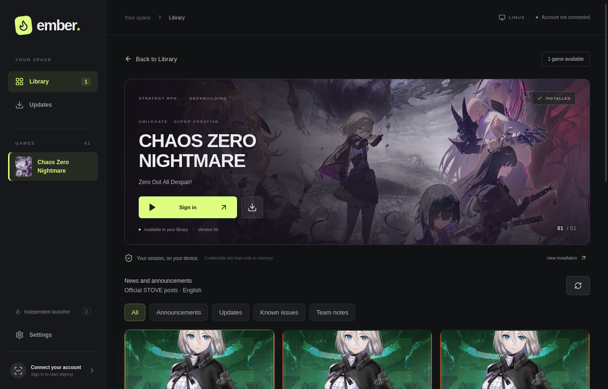
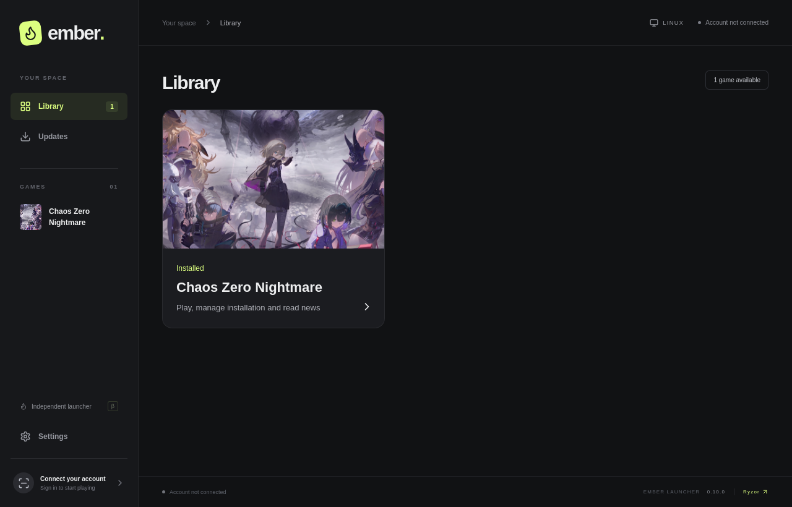

  
  <h1>Ember Launcher</h1>
  
A standalone alternative STOVE launcher for Linux and Windows.

  
Currently supports <strong>Chaos Zero Nightmare</strong>.

  
<a href="https://github.com/iRyzor/EmberLauncher/releases">Download the beta</a> · <a href="docs/BUILDING.md">Build from source</a> · <a href="https://github.com/iRyzor/EmberLauncher/issues">Report an issue</a>

Screenshots show the current development interface. Existing release packages may look slightly different.

## What you can do

- **Play without the official launcher.** Start Chaos Zero Nightmare and close your running game directly from Ember.
- **Sign in with QR.** Approve access in the official STOVE mobile app. Ember never asks for your password.
- **Keep your session.** Optional “Remember me” uses your operating system's credential store.
- **Manage your installation.** Install the game, check for updates, repair files, resume downloads, or move an installation to the trash.
- **Read official news.** Browse STOVE announcements inside the launcher, with an in-app reader.
- **Choose your language.** English and Spanish are available. News posts retain their original language.

## Get started

1. Download a package from [Releases](https://github.com/iRyzor/EmberLauncher/releases).
2. Open Ember and select your existing installation, or use the setup guide to create a new one.
3. Scan the QR code with the STOVE mobile app and approve the sign-in.
4. Install any required game files, then press **Play now**.

Ember downloads the official startup files. The game downloads its additional content on first launch.

### Packages and requirements

| Platform | Packages | Status |
| --- | --- | --- |
| Linux x86_64 | AppImage, `.deb`, portable `.tar.gz` | Tested with Wine on Linux |
| Windows x64 | Setup `.exe`, portable `.zip` | Experimental; testing on Windows hardware is pending |
| macOS | No current package | Experimental source support |

The current Linux packages require **glibc 2.44 or newer**, GTK3, WebKitGTK 4.1 and Wine. An AppImage does not remove the glibc requirement. Future CI packages may have different requirements; check each release's notes.

Windows needs **Microsoft Edge WebView2 Runtime**. The setup installer can download it when needed. Portable packages must be extracted in full; keep the executable, engine and native helpers together. Current Windows builds are unsigned.

You do not need Python or Node.js to run a downloaded package. See [compatibility](docs/COMPATIBILITY.md) for the current limits.

## A library built around your game

A focused library, installation controls and official announcements in one place. Chaos Zero Nightmare is the only supported game today; support for other titles is not implied.

## Your account stays on your device

Your password is never collected. Session tokens remain in Ember's private engine and are not sent to the interface. Without “Remember me”, they are discarded when Ember closes. With it enabled, the refresh credential is stored in the system credential manager.

“Remember me” is optional and off by default. Its real restore flow in Ember still needs broader validation. Read the [privacy notes](docs/PRIVACY.md) for storage, deletion and reporting guidance.

## Development

Built with **Rust, Tauri 2, React and TypeScript**. See [Building](docs/BUILDING.md) for prerequisites and commands, and [Contributing](CONTRIBUTING.md) for useful bug reports and changes.

Developed by [Ryzor](https://github.com/iRyzor).

---

Ember is an independent community project, not affiliated with or endorsed by STOVE, Smilegate or Super Creative. Game artwork, news content and trademarks belong to their respective owners. Service changes may affect compatibility; Ember cannot guarantee that STOVE permits alternative clients. A legitimate STOVE account and access to the game are required.
